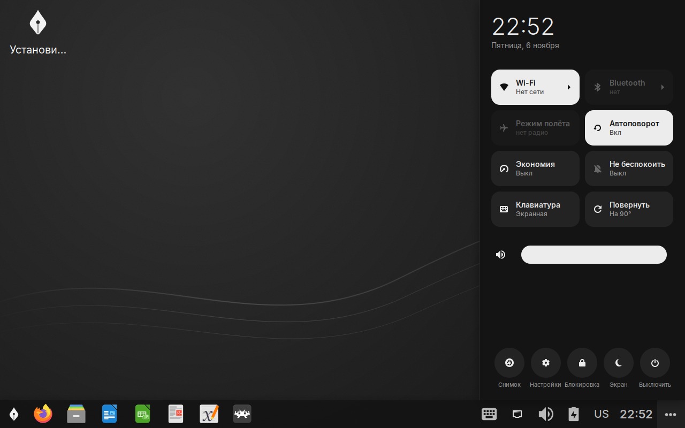
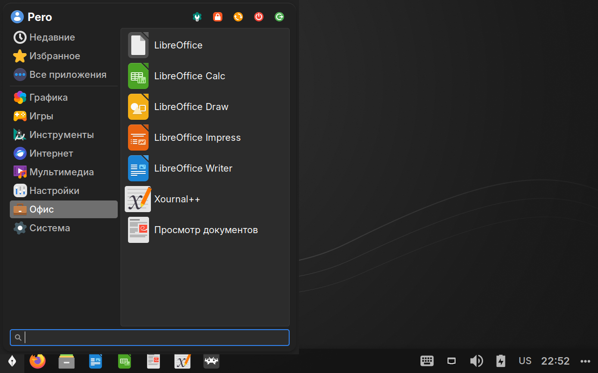
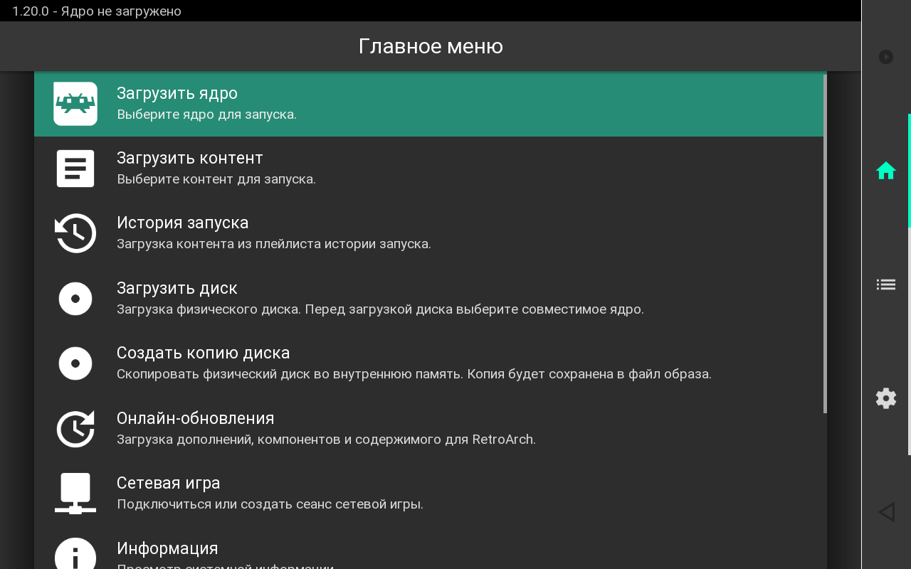

<p align="center">
  <picture>
    <source media="(prefers-color-scheme: dark)" srcset="assets/logo.svg">
    
  </picture>
</p>

<h1 align="center">Pero OS</h1>

<p align="center">
  Лёгкий Linux для работы с документами на планшете <b>Alldocube iWork 10 Pro</b>.<br>
  Debian 13 + XFCE, настроенные под палец, 32-битный UEFI и 4 ГБ памяти.
</p>

<p align="center">
  <a href="https://github.com/traumadiv/pero-os/releases/latest"></a>
  <a href="https://github.com/traumadiv/pero-os/actions/workflows/build-iso.yml"></a>
  
  
</p>

<p align="center">
  
</p>

## Скачать

Образ лежит в [последнем релизе](https://github.com/traumadiv/pero-os/releases/latest):
`pero-os-*.iso` и контрольная сумма к нему.

```bash
sha256sum -c pero-os-*.iso.sha256
```

## Что внутри

<table>
<tr>
<td width="50%"></td>
<td width="50%"></td>
</tr>
</table>

**Документы.** LibreOffice Writer, Calc и Impress на русском, со словарями и шрифтами
Carlito/Caladea вместо Calibri/Cambria. Evince для чтения PDF, Xournal++ для пометок и
подписи стилусом.

**Интернет и видео.** Firefox ESR с прокруткой пальцем. Видео декодирует видеокарта
(VA-API): YouTube отдаёт H.264, который Cherry Trail тянет аппаратно, а не VP9/AV1,
которые процессору не по силам. Кадры не копируются через процессор (DMA-BUF), а пока
видео играет в Firefox или mpv, процессор и видеокарта держат полную частоту
(`pero-cpu-boost`): у этого Atom нет режимов питания, и без этого 1080p дёргался. mpv
масштабирует картинку быстрым фильтром, H.265 декодирует на всех четырёх ядрах.

**Планшет.** Быстрые настройки справа: Wi-Fi, Bluetooth, режим полёта, автоповорот,
экономия, «не беспокоить», яркость, громкость, экран и выключение. Автоповорот экрана,
экранная клавиатура сама всплывает в полях ввода, флешки подключаются и открываются сами.

**Игры.** RetroArch с сенсорным меню и экранным геймпадом: NES, SNES, Game Boy и GBA,
Sega, аркады (FBNeo), PS1, PSP, DS, N64, Dreamcast. Пока открыт, держит режим
производительности. Игры кладутся в `~/Игры`.

**Кино.** TorrServer + mpv: фильм из торрента смотрится, пока качается. Magnet-ссылки и
файлы `.torrent` открываются сразу в плеере. TorrServer слушает только сам планшет.

**Экономия.** zram вместо подкачки на eMMC, на батарее сам включается режим «Экономия»,
простаивающие устройства засыпают. Пакеты ставятся без рекомендуемых, в покое занято
около 1,4 ГБ из 4.

### Жесты

| Жест | Действие |
|---|---|
| Свайп от правого края | быстрые настройки (или кнопка `⋯` в углу панели) |
| Касание | выделить, двойное касание — открыть |
| Долгое нажатие, касание двумя пальцами | правый клик |
| Тап по тачпаду док-клавиатуры | клик, тап двумя пальцами — правый клик |

Под пальцем расходится круг-отклик; выключить: `touch ~/.config/pero/no-ripple`.

### Сон

Настоящего сна нет: iWork 10 Pro из него не просыпается. Кнопка питания блокирует экран,
плитка «Экран» блокирует и сразу гасит его, без касаний экран гаснет сам, а процессор при
этом простаивает. Выключение: меню или удержание кнопки около 10 секунд.

## Установка

1. Запишите ISO на флешку: Rufus в режиме **DD** или balenaEtcher.
2. Подключите флешку и клавиатуру через OTG-хаб: в меню прошивки нужна клавиатура.
3. Включите планшет, жмите **Esc** (или **F7**, меню загрузки), выберите флешку.
   Флешки не видно: отключите Secure Boot.
4. Загрузится живая система. Проверьте сенсор, Wi-Fi и звук до установки.
5. Ярлык «Установить» на рабочем столе: пять шагов, 10–20 минут на eMMC. Можно стереть
   весь диск или поставить рядом с Windows. Пароль живой системы: `live`.

Установщик сам выбирает GRUB под 32- или 64-битный UEFI и кладёт загрузчик во все места,
откуда его может запустить прошивка (`EFI/BOOT`, `EFI/debian`, без Windows и
`EFI/Microsoft/Boot`, куда ведёт пункт «Windows» меню Alldocube).

## Обновление

Скрипты, настройки, прошивка сенсора, обои и загрузчик обновляются без переустановки:

```bash
sudo pero-update
```

`pero-update` скачивает свежий `main`, раскладывает файлы и, если с ним пришла новая
версия его самого, передаёт работу ей. Настройки в домашней папке подтягиваются сразу
(или при следующем входе, `pero-user-setup`). После обновления перезагрузите планшет.
Пакеты Debian обновляются как обычно, через apt.

Если `pero-update` в системе ещё нет:

```bash
curl -fsSLo /tmp/pero-update https://raw.githubusercontent.com/traumadiv/pero-os/main/config/includes.chroot/usr/local/sbin/pero-update && sudo bash /tmp/pero-update
```

## Если что-то не работает

Сначала **«Отчёт о железе»** (меню → Система): он собирает в `~/pero-hwinfo.txt` всё, что
нужно для разбора, включая память, видео, USB и журнал игр.

<details>
<summary><b>Сенсор попадает мимо или зеркально</b></summary>

Меню → Система → «Калибровка сенсора» (`pero-touch-calibrate`): коснуться 13 крестиков.
Касания читаются прямо с сенсора, поэтому калибровка работает, как бы криво ни шли
касания до неё. Результат (`~/.config/pero/touch-calibration`) применяет `pero-touchd`.

Сенсор работает по стандарту Silead: драйвер `silead` берёт прошивку iWork 10 Pro из
`/lib/firmware/silead/mssl1680.fw`, размер панели задан параметром ядра
`i2c_touchscreen_props` в `/etc/default/grub.d/80-pero-touch.cfg`.

Экран повёрнут боком: `echo 1 > ~/.config/pero/rotation-offset` (0–3, шаг 90°), затем
`pero-rotate normal`.
</details>

<details>
<summary><b>Планшет выключился сам или гаснет при «98 %»</b></summary>

Раз в минуту в `/var/log/pero-power.log` пишутся заряд, напряжение, ток и температура,
журнал сохраняется между запусками (`journalctl -b -1 -n 50`). Резкий скачок заряда к
нулю: ошибка датчика заряда. Падающее напряжение: изношенная батарея. Рост температуры:
перегрев.

Гаснет без зарядки при «98 %»: батарея изношена. Под нагрузкой напряжение проседает до
~3,3 В, и контроллер питания AXP288 аварийно отключает планшет, хотя датчик показывает
почти полный заряд. У полной батареи `volt=` 4100–4200 мВ. Лечится заменой батареи.
</details>

<details>
<summary><b>Игры вылетают или тормозят</b></summary>

`pero-games` запускает RetroArch с `/etc/pero/retroarch.cfg` поверх ваших настроек: без
многопоточного видео (частая причина вылетов на Intel), звук через PipeWire, ядро не может
переключить RetroArch на Vulkan, а без нужного BIOS игра не стартует и пишет, чего не
хватает. Журнал последнего запуска: `~/.cache/retroarch/retroarch.log`, при вылете придёт
уведомление.

Ядра, которых нет в Debian, взяты из стабильной сборки libretro 1.20.0, той же версии, что
и сам RetroArch, и одинаковы на всех планшетах. Ставит и обновляет их `sudo pero-cores`,
его же вызывает `pero-update`. Обновление ядер из меню RetroArch выключено: ночные сборки
и были главной причиной вылетов.

Пока игра открыта, касания идут в неё напрямую: без жестов, правого клика и круга-отклика,
иначе кнопки экранного геймпада срабатывали с задержкой.

BIOS кладётся в `~/.config/retroarch/system`. PS1, PSP, DS и Dreamcast запускаются и без
него. Аркадам Neo Geo нужен `neogeo.zip` рядом с играми.

Тормозит: оставьте родное разрешение и включите пропуск кадров в настройках ядра.
Тяжёлые игры PSP, N64 и Dreamcast планшету не по силам. PS2, GameCube, 3DS и Vita не
поддерживаются.
</details>

<details>
<summary><b>Флешка не видна</b></summary>

USB-контроллер и флешки не засыпают, а Thunar монтирует их сам. Если флешка всё равно не
появилась, в отчёте о железе есть раздел USB: в нём видно, дошла ли она до ядра.
</details>

<details>
<summary><b>Wi-Fi отваливается</b></summary>

RTL8723BS уже настроен без энергосбережения: с ним он теряет сеть.
</details>

## Сборка

**GitHub Actions.** Каждый push в `main` и в ветки `fix/…` собирает образ: Actions →
«Build ISO» → Artifacts → `pero-os-iso`. Тег `v*` публикует последний собранный образ
как релиз.

**Windows (WSL2).** Скрипт сам поставит Debian в WSL. Образ появится в `out\`.

```bash
powershell -ExecutionPolicy Bypass -File .\build.ps1
```

**Linux (Debian 13).** Очистка: `sudo ./build.sh clean`.

```bash
sudo ./build.sh
```

### Проверка в QEMU

Из WSL, нужны `qemu-system-x86`, `ovmf`, `socat`, `netpbm`:

```bash
bash test/qemu-live.sh start out/pero-os-*.iso ia32 disk.qcow2
```

`ia32` — 32-битный UEFI, как у планшета, `x64` — обычный. Дальше `shot файл.png`,
`click x y`, `touch down 0 x y wait 1 up 0`, `key ret`, `type текст`, `stop`.
Память VM: `MEM=4096`.

### Структура

```
auto/                   live-build: параметры образа
config/package-lists/   список пакетов
config/includes.chroot/ файлы поверх системы: скрипты pero-*, настройки XFCE, Firefox, RetroArch
config/hooks/           донастройка внутри образа
assets/                 логотип, обои, экран приветствия (SVG)
docs/                   скриншоты для этого README
tools/                  сборка набора ядер libretro
test/                   проверка ISO в QEMU (32- и 64-битный UEFI)
build.sh / build.ps1    сборка
```

## Откуда что

Debian, XFCE, Calamares, LibreOffice, Firefox ESR, RetroArch и ядра из Debian ставятся
пакетами. Ядра PPSSPP, PCSX ReARMed, melonDS DS, Mupen64Plus-Next, Flycast, FBNeo и
FCEUmm собраны `tools/make-cores.sh` из стабильной сборки libretro 1.20.0, лежат в релизе
[`cores-1.20.0`](https://github.com/traumadiv/pero-os/releases/tag/cores-1.20.0) и
сверяются по `usr/share/pero/cores.sha256`; FBNeo только для некоммерческого
использования. [TorrServer](https://github.com/YouROK/TorrServer) (GPL-3.0) скачивается
при сборке с его релизов.
